# Diagrama del pipeline `prepararDatos`

Este diagrama representa el flujo del pipeline reproducible implementado con **DVC** para la preparación de datos de la ENTI 2022 del INEGI.

```mermaid
flowchart LR
    subgraph RAW["📥 Datos crudos · INEGI ENTI 2022"]
        A["data/raw/<br/>conjunto_de_datos_hog_enti_2022.csv<br/><i>65,862 hogares × 132 cols</i>"]
        B["data/raw/<br/>conjunto_de_datos_viv_enti_2022.csv<br/><i>64,803 viviendas × 54 cols</i>"]
    end

    subgraph SRC["⚙️ src/preparar_datos.py"]
        direction TB
        C1["1. Merge por llaves<br/><code>ent · con · upm · n_pro_viv · v_sel · per</code>"]
        C2["2. Selección de 33 columnas relevantes"]
        C3["3. Renombrado a nombres descriptivos"]
        C4["4. Conversión de tipos<br/><i>str → int64 / float64</i>"]
        C5["5. Tratamiento de códigos especiales<br/><i>9 = No especificado → NaN</i>"]
        C6["6. Eliminación de viviendas incompletas<br/><i>7,618 hogares sin cuestionario</i>"]
        C7["7. Imputación de <code>origen_agua</code><br/><i>-1 = No aplica</i>"]
        C8["8. Variable objetivo binaria<br/><code>tiene_trabajo_infantil</code>"]
        C9["9. Mapeo de entidad a nombre"]

        C1 --> C2 --> C3 --> C4 --> C5 --> C6 --> C7 --> C8 --> C9
    end

    subgraph OUT["📤 Salida procesada"]
        D["data/processed/inegi_procesado.csv<br/><b>58,244 hogares × 35 columnas</b>"]
    end

    A --> C1
    B --> C1
    C9 --> D

    style RAW fill:#fff3cd,stroke:#b8860b,stroke-width:2px
    style SRC fill:#cfe2ff,stroke:#0d6efd,stroke-width:2px
    style OUT fill:#d1e7dd,stroke:#198754,stroke-width:2px
    style A fill:#ffe9b0
    style B fill:#ffe9b0
    style D fill:#b7e4c7
```



---

## Descripción de las etapas

| # | Etapa | Entrada | Salida | Descripción |
|---|-------|---------|--------|-------------|
| 1 | **Carga** | 2 CSV crudos | DataFrames | Lectura con `dtype=str` y `encoding='utf-8'` |
| 2 | **Merge** | Hogar + Vivienda | 65,862 × 180 | Unión por 6 llaves comunes |
| 3 | **Selección** | 180 columnas | 33 columnas | Filtro a variables relevantes |
| 4 | **Renombrado** | Nemónicos | Nombres legibles | `tcti` → `trabajo_infantil_total` |
| 5 | **Tipos** | `str` | `int64`/`float64` | Conversión numérica |
| 6 | **Códigos especiales** | `9` | `NaN` | El código 9 = "No especificado" del INEGI |
| 7 | **Eliminación** | 65,862 filas | 58,244 filas | 7,618 hogares sin cuestionario de vivienda |
| 8 | **Imputación** | `origen_agua` con NaN | `-1` | Variable condicional (no aplica sin agua entubada) |
| 9 | **Variable objetivo** | `trabajo_infantil_total` | `tiene_trabajo_infantil` | Binaria: 1 si > 0 |
| 10 | **Geografía** | `entidad` (código) | `entidad_nombre` | Mapeo a nombre del estado |

---

## Reproducir el pipeline

Desde la raíz del proyecto:

```bash
dvc repro
```

**Comportamiento:**
- **Primera ejecución:** corre `python src/preparar_datos.py` y regenera `data/processed/inegi_procesado.csv`.
- **Ejecuciones posteriores:** DVC calcula hashes de las dependencias. Si nada cambió, omite la etapa. Si algún archivo de `deps` cambió (por ejemplo, editaste el script), re-ejecuta automáticamente.

**Forzar re-ejecución completa:**

```bash
dvc repro -f
```

---

## Esquema del pipeline en formato tabla

| Entrada | Proceso | Salida |
|---------|---------|--------|
| `data/raw/hog_enti_2022.csv` | Merge por llaves | `data/processed/inegi_procesado.csv` |
| `data/raw/viv_enti_2022.csv` | Limpieza y transformaciones | |
| `src/preparar_datos.py` | | |

---

## Herramientas utilizadas

| Herramienta | Rol |
|-------------|-----|
| **Git** | Control de versiones del código, la documentación y el pipeline |
| **DVC** | Versionado de datos grandes y pipeline reproducible |
| **Python 3** | Lenguaje de procesamiento |
| **pandas** | Manipulación de DataFrames |

---

## Ver también

- `src/preparar_datos.py` — código del pipeline
- `dvc.yaml` — definición del stage DVC
- `reports/notebook_prepararDatos.ipynb` — documentación detallada del proceso
- `README.md` — descripción general del proyecto