```mermaid
flowchart LR
    subgraph RAW[" Datos crudos (INEGI ENTI 2022)"]
        A[data/raw/conjunto_de_datos_hog_enti_2022.csv]
        B[data/raw/conjunto_de_datos_viv_enti_2022.csv]
    end

    subgraph SRC["⚙️ Proceso de transformación"]
        C[src/preparar_datos.py]
        C1[Merge por llaves: ent, con, upm, n_pro_viv, v_sel, per]
        C2[Selección de columnas relevantes]
        C3[Renombrado a nombres descriptivos]
        C4[Conversión de tipos]
        C5[Tratamiento de códigos especiales INEGI]
        C6[Eliminación de viviendas incompletas]
        C7[Creación de variable binaria<br/>tiene_trabajo_infantil]
        C --> C1 --> C2 --> C3 --> C4 --> C5 --> C6 --> C7
    end

    subgraph OUT["📤 Salida procesada"]
        D[data/processed/inegi_procesado.csv<br/>58,244 hogares × 35 columnas]
    end

    A --> C
    B --> C
    C7 --> D

    style A fill:#ffe4b5
    style B fill:#ffe4b5
    style C fill:#cce5ff
    style D fill:#d4edda
```

```mermaid
flowchart LR
    subgraph RAW["📥 Datos crudos (INEGI ENTI 2022)"]
        A[data/raw/conjunto_de_datos_hog_enti_2022.csv]
        B[data/raw/conjunto_de_datos_viv_enti_2022.csv]
    end

    subgraph SRC["⚙️ Proceso de transformación"]
        C[src/preparar_datos.py]
        C1[Merge por llaves: ent, con, upm, n_pro_viv, v_sel, per]
        C2[Selección de columnas relevantes]
        C3[Renombrado a nombres descriptivos]
        C4[Conversión de tipos]
        C5[Tratamiento de códigos especiales INEGI]
        C6[Eliminación de viviendas incompletas]
        C7[Creación de variable binaria<br/>tiene_trabajo_infantil]
        C --> C1 --> C2 --> C3 --> C4 --> C5 --> C6 --> C7
    end

    subgraph OUT["📤 Salida procesada"]
        D[data/processed/inegi_procesado.csv<br/>58,244 hogares × 35 columnas]
    end

    A --> C
    B --> C
    C7 --> D

    style A fill:#ffe4b5
    style B fill:#ffe4b5
    style C fill:#cce5ff
    style D fill:#d4edda
```

# Diagrama del pipeline de preparación de datos

El siguiente diagrama representa el flujo del pipeline `prepararDatos` implementado con DVC. Muestra los archivos de entrada, el script de transformación y el archivo procesado de salida.



## Descripción del flujo

| Etapa | Descripción |
|---|---|
| **Entrada** | Dos archivos CSV crudos del INEGI: base de Hogar (65,862 filas × 132 cols) y base de Vivienda (64,803 filas × 54 cols) |
| **Merge** | Integración por las llaves compartidas: `ent`, `con`, `upm`, `n_pro_viv`, `v_sel`, `per` |
| **Selección** | Filtrado a 33 columnas relevantes para el análisis de trabajo infantil |
| **Renombrado** | Conversión de nemónicos (`tcti`, `p21`, etc.) a nombres descriptivos (`trabajo_infantil_total`, `material_piso`) |
| **Tipos** | Conversión de variables numéricas de `str` a `int64`/`float64` |
| **Códigos especiales** | Reemplazo del código `9` (No especificado del INEGI) por `NaN` |
| **Eliminación** | Remoción de 7,618 hogares sin datos completos de vivienda |
| **Variable objetivo** | Creación de `tiene_trabajo_infantil` (binaria: 0 o 1) |
| **Salida** | Archivo procesado con 58,244 hogares y 35 columnas, listo para el análisis |

## Reproducibilidad

El pipeline se reproduce con:

```bash
dvc repro
```

DVC verifica los hashes de las dependencias (`src/preparar_datos.py` y los dos CSV crudos). Si alguno cambió, vuelve a ejecutar la etapa. Si nada cambió, omite la ejecución.

## Herramientas utilizadas

- **Git** — Control de versiones del código y la documentación.
- **DVC** — Versionado de datos y pipeline reproducible.
- **Python + pandas** — Procesamiento y transformación de datos.# Diagrama del pipeline de preparación de datos

El siguiente diagrama representa el flujo del pipeline `prepararDatos` implementado con DVC. Muestra los archivos de entrada, el script de transformación y el archivo procesado de salida.



## Descripción del flujo

| Etapa | Descripción |
|---|---|
| **Entrada** | Dos archivos CSV crudos del INEGI: base de Hogar (65,862 filas × 132 cols) y base de Vivienda (64,803 filas × 54 cols) |
| **Merge** | Integración por las llaves compartidas: `ent`, `con`, `upm`, `n_pro_viv`, `v_sel`, `per` |
| **Selección** | Filtrado a 33 columnas relevantes para el análisis de trabajo infantil |
| **Renombrado** | Conversión de nemónicos (`tcti`, `p21`, etc.) a nombres descriptivos (`trabajo_infantil_total`, `material_piso`) |
| **Tipos** | Conversión de variables numéricas de `str` a `int64`/`float64` |
| **Códigos especiales** | Reemplazo del código `9` (No especificado del INEGI) por `NaN` |
| **Eliminación** | Remoción de 7,618 hogares sin datos completos de vivienda |
| **Variable objetivo** | Creación de `tiene_trabajo_infantil` (binaria: 0 o 1) |
| **Salida** | Archivo procesado con 58,244 hogares y 35 columnas, listo para el análisis |

## Reproducibilidad

El pipeline se reproduce con:

```bash
dvc repro
```

DVC verifica los hashes de las dependencias (`src/preparar_datos.py` y los dos CSV crudos). Si alguno cambió, vuelve a ejecutar la etapa. Si nada cambió, omite la ejecución.

## Herramientas utilizadas

- **Git** — Control de versiones del código y la documentación.
- **DVC** — Versionado de datos y pipeline reproducible.
- **Python + pandas** — Procesamiento y transformación de datos.# Diagrama del pipeline de preparación de datos

El siguiente diagrama representa el flujo del pipeline `prepararDatos` implementado con DVC. Muestra los archivos de entrada, el script de transformación y el archivo procesado de salida.


## Descripción del flujo

| Etapa | Descripción |
|---|---|
| **Entrada** | Dos archivos CSV crudos del INEGI: base de Hogar (65,862 filas × 132 cols) y base de Vivienda (64,803 filas × 54 cols) |
| **Merge** | Integración por las llaves compartidas: `ent`, `con`, `upm`, `n_pro_viv`, `v_sel`, `per` |
| **Selección** | Filtrado a 33 columnas relevantes para el análisis de trabajo infantil |
| **Renombrado** | Conversión de nemónicos (`tcti`, `p21`, etc.) a nombres descriptivos (`trabajo_infantil_total`, `material_piso`) |
| **Tipos** | Conversión de variables numéricas de `str` a `int64`/`float64` |
| **Códigos especiales** | Reemplazo del código `9` (No especificado del INEGI) por `NaN` |
| **Eliminación** | Remoción de 7,618 hogares sin datos completos de vivienda |
| **Variable objetivo** | Creación de `tiene_trabajo_infantil` (binaria: 0 o 1) |
| **Salida** | Archivo procesado con 58,244 hogares y 35 columnas, listo para el análisis |

## Reproducibilidad

El pipeline se reproduce con:

```bash
dvc repro
```

DVC verifica los hashes de las dependencias (`src/preparar_datos.py` y los dos CSV crudos). Si alguno cambió, vuelve a ejecutar la etapa. Si nada cambió, omite la ejecución.

## Herramientas utilizadas

- **Git** — Control de versiones del código y la documentación.
- **DVC** — Versionado de datos y pipeline reproducible.
- **Python + pandas** — Procesamiento y transformación de datos.